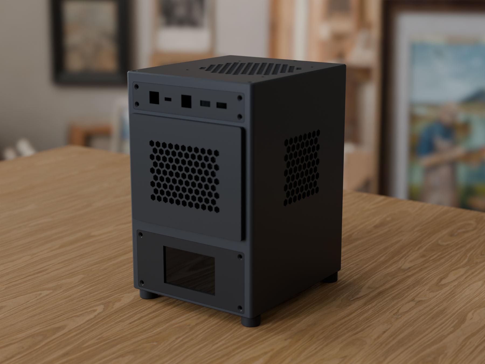
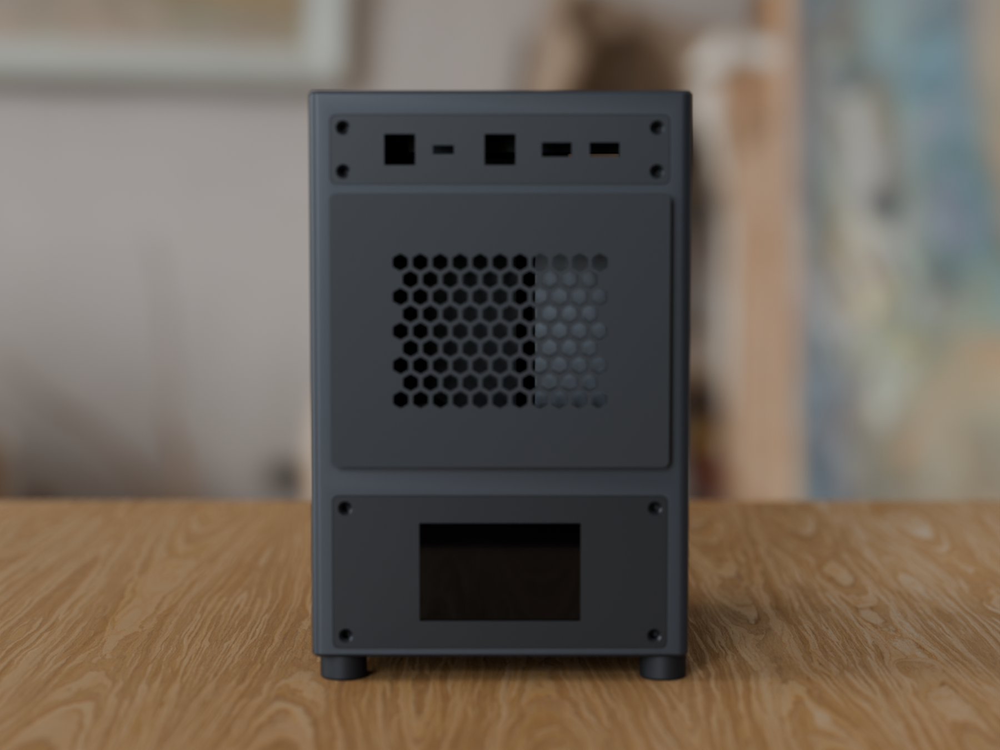
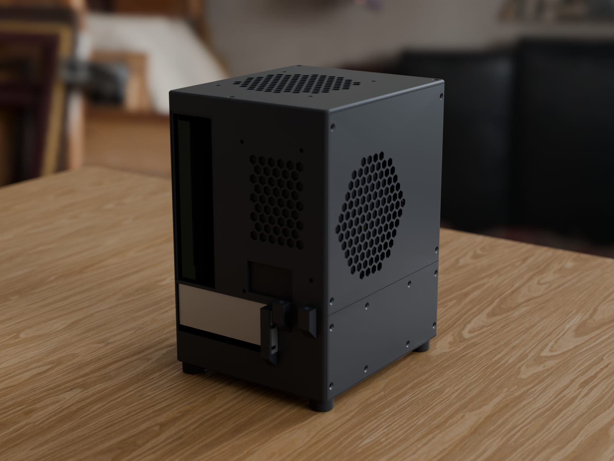
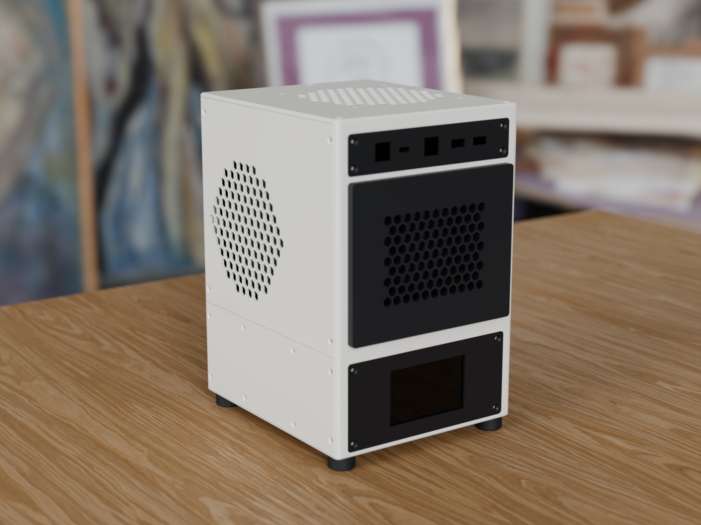

# Mini PC Case — 3D printed mATX case

A 9.7 L tower case for an mATX board, a dual-slot GPU and a standard ATX power supply, designed in
FreeCAD as one parametric Python script and printed on a Creality K1 (220 × 220 × 250 mm) from one
spool of PETG.

**Live viewer:** https://pccase.cobanov.dev — rotate, explode, airflow animation, dimensions, swap the
front panels, recolor the parts, and toggle a Steam Machine and an iPhone 18 Pro Max next to it for scale.

  

## Highlights

- **Fits a 220 mm bed.** The body splits at Z = 80 mm into two upright prints (tallest part 178 mm),
  joined by an inner lip, two alignment pegs and four M3 screws. Every opening stays within one part.
- **Steam Machine compatible front plate.** The upper front is a 156 × 126.1 × 6.5 mm plate held by four
  magnets at the positions taken from Valve's official `steam_machine_3d.stp`, using common 20 × 10 × 2 mm neodymium
  bars. Stock, Inkterface and third party Steam Machine faceplates attach to this case as well.
- **Three upper fronts.** Print the upper body with the Steam Machine plate mount, with a plain hex mesh and no plate,
  or with a screwed 156 × 126.1 panel frame that takes your own panel (mesh, plain, screen window, 120 mm fan).
- **Swappable panels** everywhere else: lower front 156 × 72 (LCD window, plain, mesh), control strip 156 × 32
  above the plate (Cherry MX power/reset switches with USB-C + 2 × USB-A, or switches only), all on M3 countersunk screws into heat-set inserts.
  One placement rule for every removable part: screws 6 mm from the visible edge, clear of the corner radii.
- **Removable PSU support.** The bracket that carries the PSU is its own screwed-in part with a footprint outline on
  the floor, so a PSU of another depth only needs a different support.
- **Chimney airflow.** 120 mm intake in the floor under the GPU, 120 mm exhaust in the lid, both Molex powered.
  The CPU cooler and GPU sit in a straight path between them; the PSU breathes through its own side grille.
- **Checked, not hoped.** `build_case.py` validates every solid, runs a clash check against the hardware models,
  scans every part in its print orientation for unsupported bridges longer than 18 mm, and audits all 37
  screw positions (insert present, mating hole present, nothing clipped, 2.2 mm of material around every head).

## Hardware it was designed around

| Part | Model |
|---|---|
| Motherboard | ASUS PRIME H310M-K (mATX, 226 × 185 mm, 6 standoffs) |
| CPU / cooler | Intel i3-8100, PCCOOLER RC400 low profile (53 mm, 90 mm fan) |
| GPU | ASUS Phoenix GTX 1050 Ti (192 × 111 × 37 mm, 2 slots) |
| PSU | Standard ATX 150 × 86 × 140 mm (socket bottom center, switch left) |
| Storage | 2.5" SSD on the inside of the lower side cover |
| Fans | 2 × 120 × 25 mm, Molex |

Other mATX boards following the ATX 2.2 hole pattern should fit; check `GPU_TAB_H` and the cooler height.

## Files

| Path | What |
|---|---|
| `build_case.py` | The whole design. Run inside FreeCAD (`exec(open("build_case.py").read())`) or headless with `freecadcmd`. All dimensions are parameters at the top. |
| `stl/` | Print-ready STLs in print orientation, plus STEP files in assembly coordinates. Includes the panel variants and a small test piece for the I/O and GPU openings. |
| `slice_k1.sh`, `gcode/profiles/` | OrcaSlicer CLI slicing for a Creality K1 with complete (inherits-resolved) PETG and PLA profiles; each G-code is checked against them. `./slice_k1.sh 06 07` slices only those parts. |
| `ASSEMBLY.md` | Bill of materials (inserts, screws, magnets), print settings, joint details, assembly order and the specs for designing your own panels. |
| `NOTES.md` | Dimension sources: ATX 2.2, ATX12V PSDG, board manual. |
| `docs/` | The web viewer (three.js), served at pccase.cobanov.dev. |
| `render/render_case.py` | Blender (Cycles) scene for the README renders, built from the viewer meshes: `blender -b -P render/render_case.py` (`PREVIEW=1` for a quick pass). HDRI and oak texture are CC0 from Poly Haven, in `render/assets/`. |

## Printing

PETG, 0.2 mm layers, 3 perimeters, 20 % gyroid, no supports. Walls are 2.2 mm, lid 3 mm, outer corners R5.
Print the body halves upright (brims welded to the wall, no skirt: the footprint leaves ~2 mm to the bed edge), lid and
panels face down. Wide openings carry breakaway rib grids instead of supports; snap them off after printing.
Total ≈ 663 cm³ (~845 g) plus the Steam plate (103 cm³ mesh, ~65 g at 20 % infill).

## Licence

Code (`build_case.py`, `docs/`): MIT. Models, STLs and documentation: CC BY-NC-SA 4.0, because the Steam Machine
plate geometry derives from Valve's CAD release, published under the same licence. The Steam Machine shown for scale
in the viewer is meshed from that release. See `LICENSE` and `LICENSE-models.md`.
